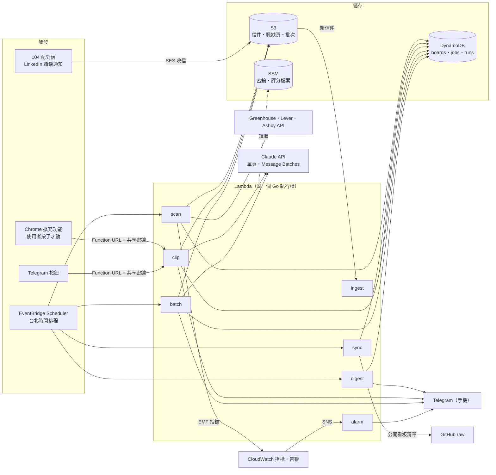
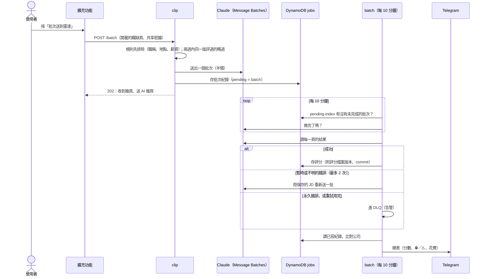

# 職缺雷達架構說明

## 1. 為什麼要做

**現有工具（career-ops）的痛點**：它只在 Mac 開機、App 開著時才會跑（2026-10-05 到 10-08 連續 4 天沒跑）。結果散在 6 個資料夾，看不出它做了什麼，也不會主動通知。每天還白打約 6,000 個已經不存在的看板，而且 404、429、逾時全部被算成「無法連線」。

**雷達補上的事**：
- 雲端 24 小時執行；
- 每天一則摘要傳到手機，裡面就是執行看板；
- 用職缺 ID 判斷是不是新職缺；
- 已經不存在的看板會自動跳過。

**和 career-ops 怎麼分工（不是取代）**

| 工作 | 誰負責 |
|---|---|
| Greenhouse、Lever、Ashby 每天掃描並通知 | 雷達 |
| Workday 每週掃描、0–100 深入評分、投遞追蹤、客製履歷 | career-ops |

流程：雷達通知 → 點連結看 → 想投的，把網址交給 career-ops 或 Claude 做完整評分。兩邊並行兩週、比對結果後，再決定要不要關掉 career-ops 每日排程裡這三家的掃描。

## 2. 架構

### 2.1 總覽

GitHub 會把下面的 Mermaid 畫成圖。左邊是「什麼事情會叫醒系統」，中間是 7 個 Lambda，右邊是資料存在哪、結果送到哪。



### 2.2 排程與路徑（詳細）

```
EventBridge Scheduler（Asia/Taipei）
  08:00       ─► scan ×3（greenhouse｜lever｜ashby）
                  │ 每家 API 一個限速器；逾時 20 秒；429、5xx、網路錯誤重試 2 次（退避加隨機延遲，遵守 Retry-After）
                  ├─► DynamoDB job-radar-boards  看板狀態
                  ├─► DynamoDB job-radar-jobs    通過職稱篩選的職缺（用條件寫入判斷是不是新的）
                  ├─► DynamoDB job-radar-runs    每次執行的統計（保留 90 天）
                  ├─► S3 pages jd/               會通知的職缺頁面（給 AI 評分用）
                  └─► stdout 輸出 EMF 指標 ─► CloudWatch 指標、儀表板、告警
  08:40       ─► digest ─► 讀 runs、待通知的 jobs、沒送出的 104 職缺 ─► Telegram
  08:50       ─► batch（board-assess）─► 當天新的 A 類國外職缺 ─► Claude 批次評分
  每 10 分鐘  ─► batch（batch-check）─► 批次做完了 → 存評分 → Telegram 總表
  週日 07:00  ─► sync ×3 ─► 下載公開看板清單 ─► 把新看板加進 boards
  週日 20:00  ─► digest（weekly）─► 這週的新職缺、104 配對信、聯絡、投遞 ─► Telegram

104 配對信 ─► Outlook 轉寄 ─► SES 收信 ─► S3 mail 桶 ─► ingest ─► jobs（職缺、聯絡）
LinkedIn 職缺配對通知 ─► Gmail 篩選器轉寄 ─┘（連結裡的一次性登入碼不保留，只留職缺編號）

瀏覽器擴充功能「送到雷達」（使用者按了才讀頁面）
  ─► Function URL（公開網址，靠共享密鑰）─► clip
        POST /       這一頁 ─► Claude ─► Telegram 評分；jobs 存 assess#；S3 存 jd/
        GET  /jobs   某天起的 104 職缺，讓擴充功能一次開啟
        POST /batch  開著的 104、LinkedIn 分頁 ─► Claude Message Batch（半價）─► 由 batch-check 收尾
        POST /applied  104「應徵成功」頁 ─► jobs 存 104-applied#（評分、總表、日報據此標 ⛔／⚠️）
        POST /telegram  Telegram 按鈕（評分下面的標記）─► jobs 存使用者的標記
  Telegram「帶入應徵」連結 ─► 104 應徵視窗 ─► 擴充功能選好履歷、寫好推薦信（送出由人按）

CloudWatch 告警 ─► SNS ─► Email，以及 alarm 函式 ─► Telegram
秘密與個人資料 ─► SSM Parameter Store（bot token、Claude 金鑰、評分檔案、clip 密鑰、批次規則）
```

7 個 Lambda（scan、digest、sync、ingest、clip、batch、alarm）用同一個 Go 執行檔，但各自有不同的觸發方式、逾時設定和 IAM 權限。

### 2.3 批次評分的一次完整流程

最複雜的一條路：從按下「批次送到雷達」，到 Telegram 收到總表。對應 ADR 15～17、19。



## 3. 元件、用意與權衡

每一條的完整理由、當時的實測數字和沒選的做法，見 [ADR 索引](adr/README.md)。

| 元件 | 用意 | 權衡 |
|---|---|---|
| EventBridge Scheduler | 不用電腦開著；排程可以直接指定台北時區 | 傳統的 EventBridge 規則只能用 UTC |
| Lambda（Go、arm64、provided.al2023） | 一天只跑幾分鐘，用多少付多少 | 單次最長 15 分鐘，靠「最久沒檢查的先掃」接續（見 §6）。Fargate 沒有時間上限，但設定比較多 |
| DynamoDB（隨需計費） | 不需要 VPC 或 NAT；條件寫入同時做到「判斷新舊」和去重 | 臨時查詢不方便；你熟悉的 PostgreSQL 要一直開著並放在 VPC 裡 |
| SSM Parameter Store | 存 Bot token：免費、加密，用 IAM 控制誰能讀 | Secrets Manager 能自動輪替，但要收費 |
| CloudWatch EMF | 印一行 JSON 就同時有日誌和指標 | 每多一個維度，計費的指標數就倍增，所以不設維度 |
| Telegram | 免費，一個 POST 就送到手機 | 需要自己建 Bot |
| Terraform | 一個指令建立或刪除整套環境；也是職缺 JD 上常見的要求 | 比 SAM 繁瑣 |
| 不放進 VPC | 用到的都是公開端點，靠 IAM 驗證，省下 NAT 每月 30 多美元 | 面試時要能說明理由（就是上面這句） |
| SES 收信＋S3 | 104 不給 API，只會寄推薦信；收信是不碰 104 網頁的唯一來源 | 要自己的網域、Route 53 和 DKIM；Outlook 轉寄會破壞 104 的 DKIM 簽章，改看 Microsoft 驗證的結果 |
| Chrome 擴充功能（MV3） | 104 網頁有 Cloudflare 擋機器人；由使用者自己的瀏覽器讀他正在看的頁面，不繞過 | 只在裝了擴充功能的電腦能用；沒有「在背景自動讀網頁」 |
| Function URL＋共享密鑰 | 擴充功能直接呼叫，不需要 API Gateway | 網址是公開的，密鑰是唯一的門；沒有使用者帳號 |
| Claude：一個工具、固定 JSON 格式 | 職缺頁面是不可信的輸入；模型只能呼叫「記錄評分」這個工具回答，每個值都會檢查，它不能做任何動作 | 每頁約 0.02～0.04 美元；結果是判斷不是事實，所以附上原文引用，JD 也存一年供對照 |
| Message Batches | 半價，可以一次送幾十頁 | 最久 24 小時；Anthropic 不會主動通知，所以每 10 分鐘輪詢一次 |
| SNS → alarm 函式 → Telegram | 告警直接到手機，Email 當備援 | 多一個函式；它自己壞了，要靠 Email 才知道 |
| GitHub Actions＋OIDC＋人工核准 | 不存 AWS 金鑰；部署前一定有人看過 plan；部署完印出每個函式跑哪個 commit | 公開的 Actions 日誌要遮掉帳號 ID 等值；部署要等人按核准 |
| 已投紀錄放在 jobs 表、讀出來比對 | 不開新表、不加權限；剛投的馬上生效 | 公司名稱用文字比對，104 和 LinkedIn 名稱不同時對不到；要做完整求職漏斗時再評估 PostgreSQL |

**Go 程式的分層**：`ats`（每家 ATS 一個轉接器）→ `fetch`（HTTP 規則）→ `filter`（篩選規則）→ `store`（介面，有本機 JSON 和 DynamoDB 兩種實作）→ `app`（用例）。104 的信由 `mailin`（原始信件、寄件人檢查）和 `alert104`（職缺與聯絡）讀；`assess` 呼叫 Claude；`pages` 存取 S3 裡的頁面；`version` 說明正在跑的是哪個 commit。CLI 和 Lambda 呼叫同一份 `app`，所以本機能跑，就代表雲端的邏輯也是對的。只用標準庫加官方 SDK，沒有用 Web 框架或 ORM。

## 4. 資料模型

| 表 | 主鍵 | 重點 |
|---|---|---|
| boards | `ats` + `slug` | status（unknown／ok／failing／dead）、consecutive_404、last_checked_at、last_ok_at |
| jobs | `key` = `ats#slug#id` | 只存通過職稱篩選的職缺。寫入條件是 `attribute_not_exists`。另有稀疏索引 `pending-index`：只有待通知的職缺帶有 `pending` 欄位；索引 `source-index`（`ats`、`first_seen`）依來源和時間列出所有職缺，擴充功能用它列出某天起的 104 職缺，日報用它列出被規則排除的。同一張表也存評分結果（`assess#…`）、批次（`batch#…`，等待總表時 `pending` 為 `batch`，batch 函式每 10 分鐘從 `pending-index` 找出來）和投遞紀錄（`104-applied#代碼`，`ats` 是 `104-applied`、`board` 是公司名稱） |
| runs | `pk="run"` + `sk=開始時間#ats#task` | 各種結果的計數、新增數、待通知數、狀態；`expires_at` 到期自動刪除 |

評分結果（`assess#…`）的 `jd` 欄位指向 S3 pages 桶裡被評的那一頁：104 職缺是 `jd/104/<代碼>.json`，其他網站是 `jd/web/<網址雜湊>.json`，保存一年，用來對照 AI 的判斷和 JD 原文，也當評估集。每筆評分也記下用什麼評的：`profile_version` 是 SSM 裡評分檔案的版本，`commit` 是提示詞和分數規則所在的程式；批次送出和讀回答之間如果有部署，寫成 `舊→新`。Telegram 每則評分最後一行「🔖 評分檔案 v2｜程式 54efb96」顯示的就是這兩個（2026-10-29 之後的評分才有）。批次遇到兩週內評過的職缺，只有評分檔案是同一版才略過；換版後（或舊紀錄沒有版本）會重評。整批送出的原始頁面在 `batches/`，保存 30 天。掃描時，會通知的國外職缺頁面也存在 `jd/`；每天 08:50 batch 函式把前一天新出現的 A 類職缺（技能分高的先，最多 `assess.board_daily_max` 個）送 AI 批次評分，總表跟手動批次一樣由 batch-check 送出。

## 5. 篩選規則（`config/radar.yml`，移植自 career-ops）

1. **職稱**：與 career-ops `portals.yml` 相同的關鍵字。另外加了排除詞「in Test」「AI Trainer」「Trainer」，這是第一次實際執行後補上的。
2. **地點分類**（`internal/filter/location.go`）：
   - **A**：明確可以從台灣應徵。台灣遠端；台北或新竹混合辦公、每週到班 2 天以內；地點寫全球、亞太或 Anywhere in the world。
   - **B**：待確認。只寫 Remote 沒寫國家；台灣職缺但工作型態或到班天數不明；寫全球但要配合美國或歐洲時區；台中。
   - **C**：限其他國家。包含 Remote 但綁在國外城市（例如 NYC）、「Anywhere in France」、JD 寫明必須住在某國。
   - **D**：在國外辦公室上班，或台灣到班天數超過限制。
3. **技能分數**：用技能關鍵字加權計分，上限 100。不會的語言不扣分。
4. **通知門檻**：
   - A 類分數 ≥ 40，B 類分數 ≥ 60。
   - **台灣遠端職缺一律通知。** 其他台灣職缺即使是 B 類，也用 A 類的門檻（≥ 40）。

## 6. 失敗處理

| 狀況 | 做法 |
|---|---|
| 被限速（429） | 每家每秒 15 個請求、同時最多 16 個；照 Retry-After 等待後重試 |
| 回應卡住 | `http.Client.Timeout` 連讀取內容的時間都包含在內 |
| 看板不存在 | 連續 3 次 404 判定為死，之後每 7 天檢查一次；恢復正常就算「復活」 |
| 快碰到 15 分鐘上限 | 截止前 60 秒停止開新的看板，截止前 30 秒取消還在進行的抓取（卡住的看板最多可能佔用 60 秒以上，會把存檔時間吃掉）。被取消的看板不記錄，這次記為 partial；下次從最久沒檢查的看板開始，不需要存進度 |
| 重複通知 | 條件寫入；摘要送出後改成 notified，並移除 pending |
| 系統默默停了 | 24 小時內沒有成功的掃描就觸發心跳告警；摘要也會寫出哪一家今天沒有執行紀錄 |
| AI 評分失敗 | 依錯誤等級：永久錯誤（頁面太長、請求被拒）不重試；暫時錯誤（忙碌、限速、逾時、批次過期）和不明錯誤，從保存的 JD 自動重新批次，最多 2 次。放棄的進 SQS 死信佇列（DLQ，保存 14 天），總表上逐一寫出去向，DLQ 不是空的就告警 |
| 批次卡住 | 送出超過 26 小時還沒結束（Anthropic 最久 24 小時），Telegram 提醒一次 |
| 104 配對信默默停了 | 48 小時沒有解析到任何配對信（`AlertsParsed` 指標）就觸發告警 |
| 告警寄到信箱沒看到 | 告警的 SNS 主題同時訂閱 alarm 函式，用中文轉發到 Telegram；Email 保留當備援 |
| 打到非預期的網域 | 網域白名單只有三家 ATS API 加 GitHub raw；不跟隨重新導向 |
| Lambda 非同步呼叫自動重試，造成重複執行 | 排程的函式重試次數設為 0；失敗的那次連同原本的事件進 DLQ，告警通知，修好後 `make redrive` 重跑 |

## 7. 安全

- 每個函式有自己的 IAM 角色，只拿得到自己要的：只有要發 Telegram 的函式能讀 bot token；只有 scan 和 sync 能寫 boards；只有 clip 能讀 clip 密鑰；alarm 只能讀 bot token。
- Token、Claude 金鑰、評分檔案、clip 密鑰都是手動建立的 SecureString，不會出現在 Terraform state 裡。發生錯誤時，訊息裡的 token 會被遮掉。
- clip 的網址是公開的：沒有密鑰的請求在讀任何東西之前就被拒絕；太舊的擴充功能收到 426。
- 職缺頁面是不可信的輸入：模型只能呼叫「記錄評分」工具，Telegram 訊息裡的每個欄位都會跳脫（escape）。
- 個人資料（評分檔案、履歷名稱、推薦信）不在這個公開的 repo：分別在 SSM 和擴充功能的本機儲存。
- Terraform state 存在私人的 S3 bucket；`terraform.tfvars` 和 `backend.hcl` 都不提交到 git。

## 8. 費用（估計，以第一個月的帳單為準）

Lambda 在免費額度內；DynamoDB 隨需計費每月不到 1 美元；CloudWatch 約 0–2 美元；S3 存信和頁面幾乎不花錢。**AWS 合計每月約 1–3 美元。** 預算告警在 5 美元和 10 美元時寄信。刻意不用 NAT、RDS、EKS、負載平衡器。

Claude 另外計費（Anthropic）：單頁約 0.02～0.04 美元，批次半價；國外職缺每天最多 10 個（`assess.board_daily_max`），約每月 6 美元以內。每則評分和總表最後一行都寫了花費；上限設在 Anthropic Console。

## 9. 進度

| 階段 | 狀態 |
|---|---|
| 1–4 本機程式（抓取、篩選、比對、通知） | ✅ 2026-10-11 |
| 5–6 AWS、Terraform、指標、儀表板、告警 | ✅ 2026-10-13 部署 |
| 104 配對信（SES 收信、解析、日報） | ✅ 2026-10-20 |
| 送到雷達：單頁評分、批次評分、帶入應徵 | ✅ 2026-10-21～23 |
| 告警到 Telegram、版本與部署防呆、早上提醒、JD 保存、評估集、國外職缺 AI 評分 | ✅ 2026-10-23～25 |
| 錯誤分級、自動重試、DLQ、卡住提醒；背景函式失敗也進 DLQ；`make dlq`、`make redrive` | ✅ 2026-10-28 |
| Telegram 標記按鈕、週報 | ✅ 2026-10-25 |
| GitHub Actions：PR 自動 plan、按鈕加核准部署（OIDC，沒有存 AWS 金鑰） | ✅ 2026-10-29 啟用 |
| 自動記錄投遞（104「應徵成功」頁） | ✅ 2026-10-28 |
| 每筆評分記評分檔案版本和 commit；換版重評 | ✅ 2026-10-29～30 |
| LinkedIn 職缺通知（Gmail 轉寄） | ✅ 2026-11-04 |
| 已投提醒（⛔ 同一個職缺、⚠️ 同一家公司）、匯入舊投遞 | ✅ 2026-11-05 |
| 測試環境 | 未做 |
| Workday | 未做 |
